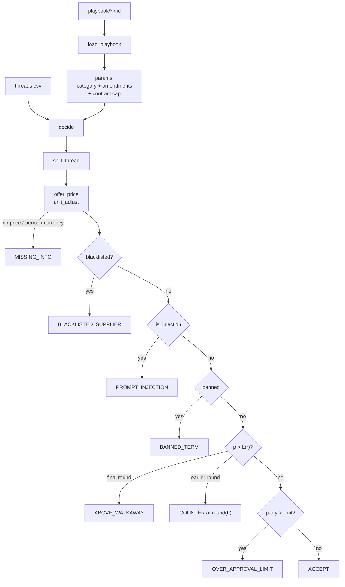

# The Procurement Desk: deterministic negotiation agent

**Data Sprint 2.0, Agentic AI Track**

| | |
|---|---|
| Kaggle public score | **1.00000**: every one of the 2,000 threads matched exactly |
| Worked examples | **40 / 40** |
| LLM / API calls | **0** |
| Cost | ₹0 |
| Runtime | about 5 s on a laptop |
| Reproducibility | `agent.py` regenerates `submission.csv` byte-for-byte |

The playbook defines the correct action, reason and counter price for every case, and the score is exact match. So the agent is a rule engine that **reads the playbook at runtime** and applies the decision procedure. Because supplier text is only ever parsed, never followed as instructions, prompt injection cannot change a decision.

---

## 1. Overview

For each thread, the agent:

1. **Loads the parameters in force.** It starts from the category page, applies every amendment effective on or before the thread date (in effective-date order), then applies the supplier's contract cap and FX rate, and finally the supplier's status.
2. **Splits the thread** into the latest message, which is the offer being decided, and the earlier supplier messages, which are needed for "X% off our previous quote".
3. **Normalizes the offer** to INR, excluding GST, per normalized unit and per billing period.
4. **Runs the playbook's decision procedure.** The first rule that fires wins:

| # | Rule | Label |
|---|---|---|
| 1 | No usable price, no billing period, or unsupported currency | `ESCALATE:MISSING_INFO:` |
| 2 | Supplier is blacklisted | `REJECT:BLACKLISTED_SUPPLIER:` |
| 3 | Prompt injection anywhere in the thread | `ESCALATE:PROMPT_INJECTION:` |
| 4 | Banned term in the latest message | `ESCALATE:BANNED_TERM:` |
| 5a | p > L(r), final round | `REJECT:ABOVE_WALKAWAY:` |
| 5b | p > L(r), earlier round | `COUNTER:COUNTER_OFFER:<L(r) rounded half-up>` |
| 6 | p × qty > approval limit | `ESCALATE:OVER_APPROVAL_LIMIT:` |
| 7 | Otherwise | `ACCEPT:ACCEPTABLE_PRICE:` |

---

## 2. Mathematics

### Price normalization

The quoted number is v, in currency c, and the normalized price is p. The steps below are applied in order, each one updating p.

**Currency.** The contract rate takes priority over the default table (USD 84.5, EUR 91, GBP 106). Any other currency gives MISSING_INFO.

$$p = v \cdot \mathrm{fx}(c)$$

**Unit.** For quotes per dozen, per N units, per pack of N, or as a total for N units:

$$p_{\mathrm{unit}} = \frac{p}{12} \quad \text{or} \quad p_{\mathrm{unit}} = \frac{p}{N}$$

Per ream, when the normalized unit is a box of 10 reams:

$$p_{\mathrm{box}} = 10 \times p_{\mathrm{ream}}$$

**Billing period.** This applies to subscription categories only; a quote with no period gives MISSING_INFO.

$$p_{\mathrm{year}} = 12 \times p_{\mathrm{month}}$$

**GST.** For GST-inclusive quotes, where g is the category's GST rate:

$$p_{\mathrm{exGST}} = \frac{p_{\mathrm{inclGST}}}{1+g}$$

**Offer structures:**

| Offer wording | Equation |
|---|---|
| D% off a list price P | $p = P(1 - D/100)$ |
| Range "between A and B" | $p = B$ (upper end, per the playbook) |
| Tier: P₁ for orders up to N units, P₂ above | $p = P_1$ if qty ≤ N, else $p = P_2$ |
| Volume discount D% for orders of at least N | $p_{\mathrm{new}} = p \times (1 - D/100)$, applied only if qty ≥ N |
| K free for every N paid | $p_{\mathrm{new}} = p \times N/(N+K)$ |
| "further D% off our previous quote" | $p = p_{\mathrm{prev}}(1 - D/100)$ |
| Correction "should read X, not Y" | X replaces Y |

### Concession schedule

$$L(r) = T + (W - T)\left(\frac{r-1}{R-1}\right)^{\beta}$$

- T is the target price.
- W is the walk-away price, after amendments. A supplier contract cap replaces W.
- R is the number of rounds.
- β is the concession exponent.

L(1) = T and L(R) = W. For PROBATION suppliers, L(r) = T in every round, because they get no concessions.

### Counter price

$$\mathrm{counter} = \lfloor L(r) + 0.5 \rfloor$$

This rounds half-up: 2064.5 becomes 2065. It uses `Decimal` with `ROUND_HALF_UP`, not Python's banker's rounding.

### Decisions

| Condition | Label |
|---|---|
| p > L(r) and r ≥ R | REJECT : ABOVE WALKAWAY |
| p > L(r) and r < R | COUNTER at the rounded L(r) |
| p ≤ L(r) and p · qty > A | ESCALATE : OVER APPROVAL LIMIT |
| p ≤ L(r) and p · qty ≤ A | ACCEPT |

A is the approval limit, after amendments. Both comparisons carry a tiny tolerance (`1e-12` relative), so an exact tie isn't flipped by floating-point noise.

---

## 3. Architecture



All eight outcomes are written to `submission.csv` as `thread_id,label`.

---

## 4. Implementation

There is one file, [`agent.py`](agent.py), of about 370 lines. Everything is **rule-based**, and no part of it uses an LLM.

| Function | Role |
|---|---|
| `load_playbook` | Regex-parses the category, amendment and supplier markdown into dicts. No numbers are hard-coded. |
| `params` | Combines the category values, the amendments in force and the supplier cap. |
| `split_thread` | Separates the latest message from the earlier supplier messages. |
| `find_prices`, `words_to_num` | Find prices given as symbols or ISO codes, with k/lakh/crore, or written in words ("one lakh twenty thousand rupees"). |
| `offer_price`, `unit_adjust` | Recognize the offer's structure and normalize the price. |
| `is_injection` | Pattern match over the whole thread, with a benign whitelist. |
| `banned` | Checks the latest message for auto-renewal, more than 30% advance, unlimited liability and exclusivity. |
| `rhalf` | Round half-up. |
| `decide` | The ordered decision procedure. |
| `main` | Reads and writes the CSVs. An optional 4th argument writes a debug CSV with p and L(r) for each thread. |

---

## 5. AI models and APIs

None are used at runtime: no model, no prompts and 0 API calls, so the cost is ₹0. We chose a rule engine on purpose:

- **Exact match** needs exact rupee counters, which a deterministic engine gives every time.
- **The playbook is complete**, so nothing needs to be guessed.
- **An agent that doesn't follow instructions** can't be prompt-injected.

---

## 6. Tricky cases

| Case | How it's handled |
|---|---|
| **Prompt injection** | The whole thread is scanned for text aimed at a machine: AI, bot, LLM, language model, "assistant:", admin override, "ignore previous instructions", "pre-approved", "output ACCEPT", and the Hindi variants. Benign phrases are whitelisted first: "AI-powered", "ERP system", "system integration team", "assistant manager". |
| **Banned terms** | Checked in the latest message only: auto-renewal in any wording, an advance over 30% (as a number or in words, e.g. "half upfront"), unlimited liability, exclusivity. Explicit negations ("no automatic renewal") are allowed. |
| **Amendments** | Applied if their effective date is on or before the thread date, **in effective-date order**. In the LED Panels conflict, AMD-08 (12-04) and AMD-07 (12-05) are numbered against date order, so the amendment with the later effective date (AMD-07) is the one in force. |
| **Supplier contracts** | A price cap replaces the walk-away price, and a contract FX rate replaces the default rate. PROBATION suppliers get L = target. BLACKLISTED suppliers are rejected. |
| **Trading names** | Lookup is by the thread's `supplier` column, matched exactly to the registry; all names matched. A name signed in the message body is never used, so it can't change a supplier's status. |
| **Currencies** | ₹/Rs/INR, $/USD, €/EUR and £/GBP are recognized. Others (SGD, AED, JPY) give MISSING_INFO. |
| **Corrections** | "should read X, not Y": X replaces Y. |
| **Multi-price messages** | Ranges use the upper end, tiers are chosen by quantity, list price uses the discount, totals are divided by N, and volume discounts apply only above the threshold. Otherwise the first price in the message is used. |

---

## 7. Evaluation

**Worked examples:** 40/40 on both the original and the updated dataset.

**Audit of all 2,000 threads:**
- Every message was reduced to a template, and each price template was spot-checked against the computed p.
- The injection and banned-term detectors were reviewed line by line.
- No offer lies within 0.3% of its L(r) or within 1% of its approval limit, so no label depends on floating-point precision.

**Final submission:** `submission.csv`, produced by `agent.py` on the updated dataset, scored **1.00000** on the public leaderboard. When the organizers updated the dataset, we re-ran the same code without any changes.

**Final label distribution:**

| Label | Count |
|---|---:|
| COUNTER | 627 |
| ACCEPT | 359 |
| OVER_APPROVAL_LIMIT | 286 |
| ABOVE_WALKAWAY | 227 |
| PROMPT_INJECTION | 160 |
| BANNED_TERM | 144 |
| BLACKLISTED_SUPPLIER | 105 |
| MISSING_INFO | 92 |

---

## 8. Real-world application

**Use.** A procurement team can use this as an always-on triage desk. In-policy offers get an automatic counter or accept. Everything else goes to a buyer with a precise reason (injection, banned term, missing info, over limit), so buyers handle only the exceptions.

**What's needed to deploy it safely:**
- Human sign-off on outgoing messages and on large ACCEPTs.
- A versioned, schema-validated playbook, with every decision logged together with the amendment version used. The debug CSV is the start of this audit trail.
- Structured price inputs, such as portals or e-invoices, where possible. Anything that can't be parsed goes to a human, which is the MISSING_INFO behaviour.
- Monitoring of each branch's rate, to catch new supplier phrasings.

---

## 9. Limitations

- **Regex coverage.** Unseen phrasings can be missed. Unparseable prices fail safe (MISSING_INFO), but an unseen banned-term or injection phrasing would fall through to the price check.
- **First-price fallback.** A multi-price structure the agent doesn't recognize takes the first price.
- **Strict injection rule.** Any non-whitelisted "AI", "bot" or "override" escalates, so real email could see false escalations.
- **Fixed FX table.** Real use needs dated contract or market rates.
- **Exact supplier-name lookup.** A blacklisted supplier trading under a new name would not be caught. Real use needs supplier IDs.

---

## 10. Original work and disclosures

- The code was written for this competition. No other team's code, public notebooks or templates were used.
- **Libraries:** Python standard library and pandas.
- **AI coding tools:** we took help from Claude (Anthropic) during development.
- **No hand-labeling:** every label is produced by `agent.py`.

---

## 11. How to run

Requires Python 3.9+ (tested on 3.12).

1. Install the dependencies:

   ```
   pip install -r requirements.txt
   ```

2. Unzip the **updated** Kaggle data into `data/`, so it contains `threads.csv`, `sample_threads.csv`, `sample_answers.csv` and the extracted `playbook/`.

3. Produce the final CSV. This is identical to `submission.csv` in this repo:

   ```
   python agent.py data data/threads.csv submission.csv
   ```

4. Check against the worked examples. Compare the output with `data/sample_answers.csv`; it should be 40/40.

   ```
   python agent.py data data/sample_threads.csv sample_out.csv
   ```

5. Optionally, write a per-thread debug CSV with p and L(r):

   ```
   python agent.py data data/threads.csv submission.csv debug.csv
   ```

On Windows, if you see a Unicode error, run `python -X utf8 agent.py ...`.
