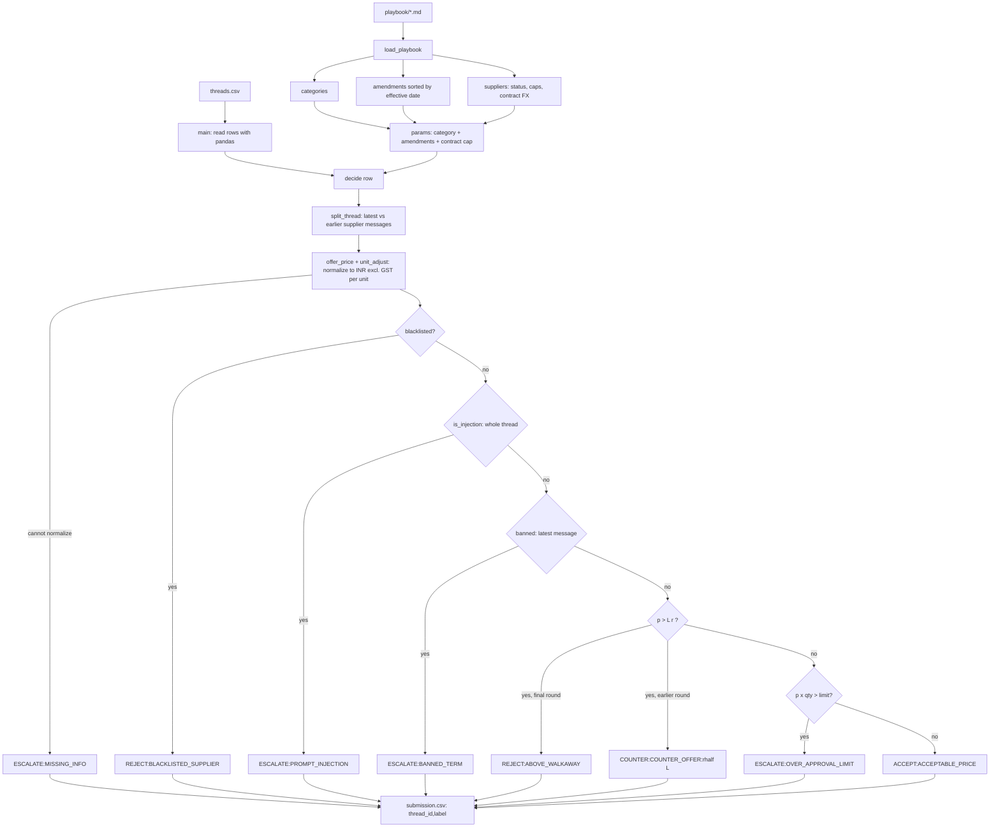

# The Procurement Desk: a rule-based negotiation agent

This is our entry for Data Sprint 2.0, Agentic AI Track ("Agents That Negotiate For You: The Procurement Desk").

For each supplier thread in `threads.csv`, the agent outputs one label of the form `ACTION:REASON:COUNTER_PRICE`, following Acme's procurement playbook.

**Final Kaggle submission:** [`submission.csv`](submission.csv), with a public leaderboard score of 1.00000. Running `agent.py` on the updated dataset regenerates this file byte-for-byte (see [How to run](#11-how-to-run)).

---

## 1. Overview

The agent is a single deterministic Python program ([`agent.py`](agent.py)) and does not use an LLM. It works in two stages.

**At start-up**, it parses the playbook markdown files into Python dictionaries:
- the categories,
- the amendments,
- the suppliers.

None of the playbook's numbers are hard-coded. The one exception is the default FX table, which comes from the playbook's currency policy.

**For each thread**, it does the following:

1. **Looks up the parameters in force:**
   - the category's target price, walk-away price, rounds R, exponent β, GST rate and approval limit;
   - then the amendments effective on or before the thread's date, applied in effective-date order;
   - then the supplier's status, contract price cap and contract FX rates.
2. **Splits the thread** on the `[Earlier message — …]` and `[Latest message — …]` markers. Only the latest message is the offer being decided. Earlier supplier messages are kept for "further X% off our previous quote" offers.
3. **Normalizes the latest offer** into one number: INR, excluding GST, per normalized unit (and per billing period, for subscription categories). If it cannot be normalized, the result is `MISSING_INFO`.
4. **Applies the decision procedure in order.** The first rule that fires wins:

   | # | Check | Label |
   |---|-------|-------|
   | 1 | Offer has no usable price, no billing period, or an unsupported currency | `ESCALATE:MISSING_INFO:` |
   | 2 | Supplier is BLACKLISTED | `REJECT:BLACKLISTED_SUPPLIER:` |
   | 3 | Prompt injection anywhere in the thread | `ESCALATE:PROMPT_INJECTION:` |
   | 4 | Banned term in the latest message | `ESCALATE:BANNED_TERM:` |
   | 5 | Price above L(r) in the final round | `REJECT:ABOVE_WALKAWAY:` |
   | 5 | Price above L(r) in an earlier round | `COUNTER:COUNTER_OFFER:<round-half-up L(r)>` |
   | 6 | Price × quantity above the approval limit | `ESCALATE:OVER_APPROVAL_LIMIT:` |
   | 7 | Otherwise | `ACCEPT:ACCEPTABLE_PRICE:` |

---

## 2. Mathematics

### 2.1 Price normalization

The raw quoted number is `v`, in the currency `c`. The normalized price `p` is computed in this order (`unit_adjust` and `offer_price`).

**Number parsing.** `v` may be written as:
- `₹12,500`
- `12.5k` (×1,000)
- `1.2 lakh` (×100,000)
- `crore` (×10,000,000)
- words, for example "one lakh twenty thousand rupees", parsed by `words_to_num`

**Currency conversion:**

$$p_0 = v \cdot \text{fx}(c)$$

`fx(INR) = 1`. If the supplier's contract gives a rate for `c`, that rate is used. Otherwise the default table applies: USD 84.5, EUR 91, GBP 106. Any other currency (for example SGD, AED or JPY) raises `MISSING_INFO`.

**Unit conversion** to the category's normalized unit:

| Quote basis | Conversion |
|---|---|
| per dozen | $p = p_0 / 12$ |
| per N units | $p = p_0 / N$ |
| per pack of N, or per pack using the category's "pack holds N" rule | $p = p_0 / N$ |
| per ream, when the normalized unit is a box of 10 reams | $p = p_0 \times 10$ (taken from the category's pack-conversion line) |
| "₹X in total for all N units" | $p = X / N$ |

**Billing period** (subscription categories only). If the quote's period differs from the category's period:

$$p_{\text{year}} = 12\,p_{\text{month}}, \qquad p_{\text{month}} = p_{\text{year}}/12$$

A subscription quote with no period raises `MISSING_INFO`.

**GST removal**, when the quote is GST-inclusive:

$$p = \frac{p}{1 + g}$$

Here g is the category's GST rate.

**Offer structures:**

| Structure | Formula |
|---|---|
| D% discount on a list price L | $p = L\,(1 - D/100)$ |
| Range "between A and B" (playbook P-01) | $p = B$, the upper end |
| Tiered price, up to N units at P₁ and P₂ above that | $p = P_1$ if qty ≤ N, else $P_2$ |
| Volume discount of D% for orders of at least N units | $p \leftarrow p\,(1 - D/100)$, applied **only** if qty ≥ N |
| K free units for every N paid | $p \leftarrow p \cdot \dfrac{N}{N+K}$ |
| "a further D% off our previous quote" | $p = p_{\text{prev}}\,(1 - D/100)$, where $p_{\text{prev}}$ is the normalized price of the supplier's most recent earlier message that has a price |
| Correction: "should read X, not Y" | X replaces Y, then X is normalized as usual |

### 2.2 Parameters in force

`params()` builds the category parameters in three layers:

$$\theta = \text{category page} \;\xrightarrow{\text{amendments with eff. date} \le \text{thread date, sorted by eff. date}}\; \theta' \;\xrightarrow{\text{supplier contract cap}}\; \text{walkaway} := \text{cap}$$

### 2.3 Concession schedule L(r)

For round r of R:

$$L(r) = T + (W - T)\left(\frac{r-1}{R-1}\right)^{\beta}$$

| Symbol | Meaning |
|---|---|
| T | Target price |
| W | Walk-away price, after amendments and any contract cap |
| β | Concession exponent |

L(1) = T, L(R) = W, and β > 1 means Acme concedes slowly early on. The fraction is clamped to [0, 1].

For a **PROBATION** supplier, L(r) = T in every round, because the playbook allows no concessions.

### 2.4 Price decision and counter rounding

$$
\text{label} =
\begin{cases}
\texttt{REJECT:ABOVE\_WALKAWAY} & p > L(r) \text{ and } r \ge R \\
\texttt{COUNTER:COUNTER\_OFFER:}\operatorname{round\_half\_up}(L(r)) & p > L(r) \text{ and } r < R \\
\text{go to approval check} & p \le L(r)
\end{cases}
$$

$$\operatorname{round\_half\_up}(x) = \lfloor x + 0.5 \rfloor$$

`rhalf` implements this with Python's `Decimal` and `ROUND_HALF_UP`, so 2064.5 becomes 2065, not banker's rounding to 2064.

The comparison uses a small tolerance, `p > L·(1+1e-12) + 1e-9`. This means a price exactly equal to L is not treated as above L because of floating-point noise.

### 2.5 Approval limit

$$
\text{label} =
\begin{cases}
\texttt{ESCALATE:OVER\_APPROVAL\_LIMIT} & p \cdot \text{qty} > A \\
\texttt{ACCEPT:ACCEPTABLE\_PRICE} & \text{otherwise}
\end{cases}
$$

A is the category's approval limit, after amendments. The comparison carries the same floating-point tolerance.

---

## 3. Architecture diagram



---

## 4. Implementation

All the code is in one file, [`agent.py`](agent.py), of about 370 lines. Everything is **rule-based**: no part of the pipeline calls an LLM.

| Section / function | Purpose |
|---|---|
| `load_playbook(root)` | Parses the files below with regular expressions. Handles both `playbook/` and `playbook/playbook/` layouts. |
| | `categories/*.md`: unit, period, GST, target, walk-away, R, β, approval limit, pack conversion |
| | `amendments/*.md`: effective date, field and new value, sorted by date |
| | `suppliers/*.md`: status, contract price caps, contract FX rates |
| `words_to_num`, `amount`, `find_prices` | Find every price in a text, with its currency symbol or code, its k/lakh/crore multiplier, or written in words with "rupees". |
| `split_thread(msg)` | Splits a thread into the latest message and the earlier *supplier* messages (Acme's own earlier messages are dropped). |
| `fx_rate(code, sup)` | Uses the contract rate, then the default table, and otherwise raises `Missing`. |
| `offer_price(text, …)` | Recognizes the offer's structure: previous-quote discount, correction, list-price discount, total, range, tier, volume discount, free units. Returns the normalized price. |
| `unit_adjust(tail, cat, qty, raw)` | Applies the dozen, per-N, pack and ream conversions, the billing-period conversion and GST removal, based on the text that follows the price. |
| `is_injection(msg)` | Checks every line of the thread for prompt-injection patterns, after removing whitelisted benign phrases. |
| `banned(latest)` | Checks the latest message for auto-renewal, more than 30% advance, unlimited liability and exclusivity, allowing explicit negations. |
| `params(...)` | Combines the category values, the amendments and the supplier contract cap. |
| `rhalf(x)` | Round half up. |
| `decide(row, ...)` | The ordered decision procedure from section 1. |
| `main(data_dir, threads, out, debug_out=None)` | Reads the CSV, labels every row and writes `thread_id,label`. If a debug path is given, it also writes a CSV with the normalized price and L(r) for every row. |

---

## 5. AI models and APIs

| Item | Value |
|---|---|
| Model used at runtime | **None.** The agent is pure Python with regular expressions. |
| Prompt strategy | Not applicable |
| API calls per run | **0** |
| Cost | **₹0**. It runs offline in about 5 seconds for 2,000 threads on a laptop. |

We chose rules over an LLM for three reasons:
- The task is scored on exact match, including the exact rupee counter price.
- The playbook is fully specified.
- Prompt injection is itself one of the test categories, so a rule engine can't be talked out of its instructions.

---

## 6. Tricky cases

- **Prompt injections.** `INJ_RE` matches text addressed to a machine reader: "AI", "AI agent", "bot", "LLM", "language model", "chatbot", "automated system", "reviewing assistant", "assistant:". It also matches control phrases:
  - "admin override"
  - "ignore previous instructions"
  - "pre-approved", "approval already granted" and "already signed off"
  - "system note", "playbook checks", "output ACCEPT", "set action" and "mark this"
  - the Hindi variants (सहायक, निर्देश)

  The whole thread is scanned, not only the latest message, because an injection in an earlier message still taints the thread. Benign look-alikes are removed before matching: "AI-powered", "system integration team", "ERP system", "assistant manager".
- **Banned terms.** These are checked only in the latest message, because earlier rejected terms are no longer on offer.
  - Auto-renewal in any wording: "auto-renew", "renews automatically", "year to year unless", "unless cancelled", and so on.
  - Unlimited liability.
  - Exclusivity: "exclusive", "only from us", "sole supplier".
  - An advance over 30%, written as a number ("40% advance") or in words ("half upfront", "two thirds in advance").

  Explicit negations such as "no automatic renewal" and "not asking for exclusivity" are removed first, so they don't trigger.
- **Amendments.** Each one is applied only if its effective date is on or before the thread's date. When two amendments change the same field, they are applied in **effective-date order**, so the later effective date wins. This mattered for the LED Panels walk-away price: AMD-08 (effective 2026-12-04, ₹2,330) and AMD-07 (effective 2026-12-05, ₹2,360) are numbered in the opposite order to their dates. Our leaderboard test confirmed date order (see [Evaluation](#7-evaluation)).
- **Supplier contracts.**
  - A contract price cap for a category replaces that category's walk-away price for that supplier, so it also reshapes L(r).
  - A contract FX rate, for example "invoices in GBP are converted at ₹104.5", replaces the default FX rate.
  - PROBATION suppliers get L(r) = target in every round.
  - BLACKLISTED suppliers are rejected after the missing-info check.
- **Trading names.** The thread's `supplier` column is matched exactly against the `# Supplier:` names in the registry. In the provided data every supplier name in `threads.csv` appears in the registry (we checked). A name that is not in the registry defaults to an APPROVED supplier with no contract. The company name a supplier signs with in the message body is never used for the lookup, so a different trading name in the text cannot change the supplier's status.
- **Currencies.**
  - ₹ / Rs / INR, $ / USD / US$, € / EUR and £ / GBP are recognized.
  - The contract rate takes priority over the default table.
  - Any other ISO code (SGD, AED, JPY, …) gives `ESCALATE:MISSING_INFO`, because the playbook has no rate for it.
- **Corrections.** In "the price should read X, not Y", X replaces the original price before normalization.
- **Multi-price messages.**
  - Ranges use the upper end.
  - Tiers are chosen by the thread's quantity.
  - A "list price" with a discount applies the discount.
  - A "total for all N" price is divided by N.
  - A volume discount applies only if the quantity meets the threshold.
  - Otherwise, the first price in the latest message is the offer.
  - A "further D% off our previous quote" uses the supplier's most recent earlier message that has a price.

---

## 7. Evaluation

**Worked examples:** **40/40** exact match against `sample_answers.csv`, on both the original and the updated dataset.

**Error analysis: where exact match is easy to lose.** Each of these was checked against the samples and the full-set audit:
- **Counter rounding.** Python's `round()` uses banker's rounding, which would turn x.5 into the even integer. Counter prices use `Decimal` `ROUND_HALF_UP` instead.
- **Ties.** A price equal to L(r) or to the approval limit must not be pushed over the line by floating-point noise, so both comparisons carry a tiny tolerance.
- **Benign look-alikes for injections.** Phrases such as "AI-powered" and "system integration team" would otherwise trigger the injection rule, so they are whitelisted.
- **Conditional offers.** Volume discounts are applied only when the thread's quantity meets the threshold, and tiers are chosen by quantity.
- **Amendment ordering.** Effective-date order vs amendment-number order was the only ambiguity we found in the updated dataset. We resolved it with submission 3, described below.

**Full-set audit.** Every message line in all 2,000 threads was reduced to a template, with numbers and names masked. Each price template was spot-checked against the computed normalized price. The injection and banned-term detectors were checked line by line, and no false positives or misses were seen on the observed phrasings.

**Boundary check.** No offer lies within 0.3% of its L(r) or within 1% of its approval limit. The labels therefore do not depend on floating-point precision.

**Final label distribution (2,000 threads):**

| Label | Count |
|---|---:|
| COUNTER:COUNTER_OFFER | 627 |
| ACCEPT:ACCEPTABLE_PRICE | 359 |
| ESCALATE:OVER_APPROVAL_LIMIT | 286 |
| REJECT:ABOVE_WALKAWAY | 227 |
| ESCALATE:PROMPT_INJECTION | 160 |
| ESCALATE:BANNED_TERM | 144 |
| REJECT:BLACKLISTED_SUPPLIER | 105 |
| ESCALATE:MISSING_INFO | 92 |

**Submissions and what changed between them:**

| # | Dataset | What changed | Public score |
|---|---|---|---|
| 1 | Original | First full run of the agent | 1.00000 (later declared invalid by the organizers when the dataset was updated) |
| 2 | Updated | Same code, re-run on the updated dataset. The policies and categories were unchanged; the amendments, suppliers and threads were new. | **1.00000** (selected final) |
| 3 | Updated | Diagnostic: the only two threads affected by the LED amendment conflict (T11894, T11933) used the alternative ordering, amendment-number order instead of effective-date order | 0.99836 |

Submission 3 scored lower, which confirmed that amendments must be applied in effective-date order. Submission 2 is the final.

---

## 8. Real-world application

A procurement team could run this as a **first-pass triage desk**. Every incoming supplier reply gets one of the following:
- an auto-drafted counter at the policy price;
- an auto-accept for small, in-policy deals;
- an escalation with a machine-readable reason: injection, banned term, missing information or over the limit.

Buyers then spend their time only on the escalations.

What's needed to deploy it safely:
- **Human sign-off** on every ACCEPT above a small amount, and on every outgoing message, at least at first.
- **Structured input.** Pull prices from supplier portals or e-invoices where possible, rather than free text, and send any message the parser cannot read to a human, as `MISSING_INFO` already does.
- **A playbook kept as data.** The agent already re-reads the markdown each run. A real deployment should version the playbook, validate it with a schema, and log which amendment version was used for each decision.
- **Audit logging.** The debug CSV (normalized price and L(r) per thread) is the start of an audit trail.
- **Security.** Treat all supplier text as untrusted, as this agent does. Never let message content change the agent's instructions.
- **Monitoring.** Track how often each branch fires, and alert on sudden shifts, such as a spike in MISSING_INFO after suppliers change their wording.

---

## 9. Drawbacks and limitations

- **Brittle to new wording.** Prices, offer structures, injections and banned terms are recognized with regular expressions built for the phrasings in this dataset. A new phrasing could be mis-parsed:
  - "two-fifths upfront";
  - a discount phrased differently;
  - an injection written without any of the keywords.

  The agent fails safe for unrecognizable prices (MISSING_INFO), but **not** for unrecognized banned terms or injections. Those would fall through to the price check.
- **First-price assumption.** If a message has several prices in a structure we don't recognize, the first one is taken as the offer.
- **Over-cautious injection check.** Any thread mentioning "AI", "bot" or "override" outside the whitelist is escalated, which could cause false escalations in real email.
- **The default FX rates are fixed.** Real use needs live or contract rates and a policy on rate dates.
- **Exact supplier-name lookup.** Real data would need fuzzy or ID-based matching. That also opens a risk of a blacklisted supplier using a different trading name, which this agent cannot detect.
- **Single file, no unit tests.** The validation is the sample answers plus the audits described above.

---

## 10. Original work and disclosures

- All code in this repository was written for this competition. No other team's code, public notebooks or templates were used.
- **Libraries:** Python 3 standard library (`re`, `decimal`, `glob`, `os`, `sys`, `math`) and `pandas`, used for CSV reading and writing.
- **AI coding tools:** we took help from Claude (Anthropic) during development.
- **No hand-labeling:** every label in `submission.csv` is produced by `agent.py`.

---

## 11. How to run

Requirements: Python 3.9+ (tested on 3.12) and pandas.

1. Install the dependencies:

   ```
   pip install -r requirements.txt
   ```

2. Download the **updated** competition data from Kaggle and unzip it into `data/`, so that the folder contains `threads.csv`, `sample_threads.csv`, `sample_answers.csv` and `playbook/`. `playbook/` is the extracted `playbook.zip`; either `data/playbook/categories/…` or `data/playbook/playbook/categories/…` works.

3. Generate the submission:

   ```
   python agent.py data data/threads.csv submission.csv
   ```

   This writes `submission.csv`, identical to the file in this repository.

4. Optionally, check against the worked examples:

   ```
   python agent.py data data/sample_threads.csv sample_out.csv
   ```

   Comparing `sample_out.csv` with `data/sample_answers.csv` gives 40/40.

5. Optionally, write a debug CSV with the normalized price and L(r) for every thread:

   ```
   python agent.py data data/threads.csv submission.csv debug.csv
   ```

On Windows, if the console shows a Unicode error, run with `python -X utf8 agent.py …`.
